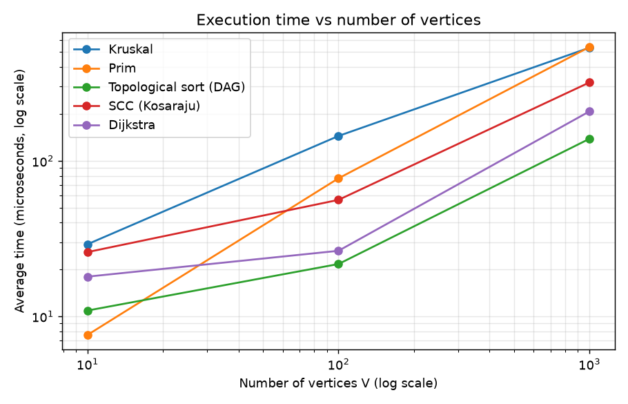
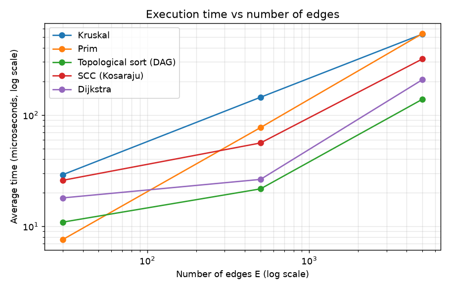
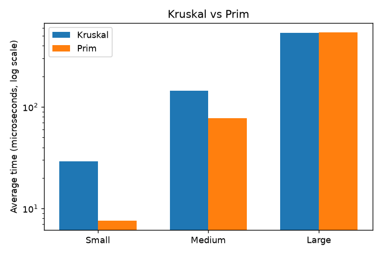

# Assignment 3: Smart City Infrastructure and Route Planning

A Java project that models a city as a graph and solves three tasks: the cheapest road network (MST),
connectivity (topological order and SCC) and shortest routes (Dijkstra). I use only basic Java:
arrays, `ArrayList`, loops and simple classes.

## 1. Overview

A city is a graph: **vertices** are districts, **edges** are roads, **weights** are construction costs or distances.
Undirected edges are two-way roads. Directed edges are one-way roads or dependencies ("A before B").

**Graph representation.** The class `Graph` keeps two things:

* `es`: a list of all edges (Kruskal sorts it).
* `adj`: an adjacency list, `adj.get(v)` are the edges that leave `v` (Prim, Dijkstra, DFS use it). It needs `O(V + E)` memory.

For an undirected graph, `add(u, v, w)` saves the edge in the lists of both ends. For a directed graph, only in the list of `u`.

```
assignment-3/
├── src/
│   ├── graph/          Edge, Graph, MinHeap, GraphGenerator
│   ├── dsu/            DSU
│   ├── mst/            Kruskal, Prim
│   ├── connectivity/   TopologicalSort, SCC
│   ├── shortestpath/   Dijkstra
│   └── Main.java, Tests.java, Experiments.java
├── results/            tables/, plots/, make_plots.py
└── README.md
```

How to run (from the project root):

```bash
javac -d out $(find src -name "*.java")
java -cp out Main
java -cp out Tests
java -cp out Experiments
python3 results/make_plots.py
```

## 2. Implementation

* **DSU.** Arrays `p` (parent) and `r` (rank). `find` goes up to the root and, with path compression, connects every vertex
  on the way directly to the root. `union` joins two roots; with union by rank the lower tree goes under the higher one.
  It returns `true` if the vertices were in different sets. Both optimizations can be switched off (used in the experiments).
* **Kruskal.** Sort the edges by weight. Take an edge if `union(u, v)` is `true` (different sets), skip it otherwise
  (it would make a cycle). Stop when the tree has `V - 1` edges. Fewer edges at the end means the graph is not connected.
* **Prim.** My own binary min-heap (`MinHeap`, on arrays). Start from vertex 0. Take the cheapest item from the heap; if its vertex is
  already in the tree, skip it; otherwise add it and push the edges to new vertices. For a disconnected graph I start again from
  every unvisited vertex, so Prim also gives a forest and `connected = false`.
* **Topological sort (Kahn).** Count `indeg` (incoming edges) for every vertex. Put vertices with `indeg = 0` in a queue. Take a vertex,
  write it down, decrease `indeg` of its neighbours (and queue those that get 0). If fewer than `V` vertices were written, there is a cycle.
* **SCC (Kosaraju).** DFS on the graph and save the finishing order; reverse all edges; run DFS on the reversed graph in reverse
  finishing order. Each DFS finds one component, so every vertex is in exactly one component.
* **Dijkstra.** `dist[v]` is the best distance found so far (`INF` = unreachable). Take the vertex with the smallest `dist` from the heap and improve
  its neighbours. `par[v]` stores the path. A negative edge weight throws an exception.
* **Graph generation.** `Random` with a fixed seed, no loops, no repeated edges, weights 1 to 100. Connected graph: first a random tree, then extra
  random edges. Directed graph: random edges (it has cycles). DAG: every edge goes from a smaller to a bigger number, so no cycle is possible.

**Why Dijkstra fails with negative weights.** It treats a distance as final when the vertex leaves the heap, and this is right only if a path can never
get shorter later. Example: `A->B = 2`, `A->C = 5`, `C->B = -4`. Dijkstra closes `B` with 2, but `A->C->B` costs 1. Bellman-Ford is needed here.

## 3. Complexity Analysis

Assumptions: adjacency list, binary heap (push and pop are `O(log n)`). `V` is the number of vertices, `E` the number of edges.

| Algorithm | Time | Space | Why |
|---|---|---|---|
| DSU find / union | `O(α(n))`, almost constant (without optimizations `O(n)`) | `O(n)` | compression flattens the trees, rank keeps them low |
| Kruskal | `O(E log V)` | `O(V + E)` | sorting `E` edges is the biggest part, DSU is almost constant |
| Prim | `O(E log V)` | `O(V + E)` | the heap has up to `E` items, each push/pop is `O(log V)` |
| Topological sort | `O(V + E)` | `O(V)` | every edge is checked twice, every vertex is queued once |
| SCC | `O(V + E)` | `O(V + E)` | two DFS, plus the reversed graph |
| Dijkstra | `O((V + E) log V)` | `O(V + E)` | at most `E + 1` heap pushes, each `O(log V)` |

`α` is the inverse Ackermann function, at most 4 for any real input. Because `E <= V²`, `log E <= 2 log V`, so `O(E log E) = O(E log V)`.
The linear algorithms grow with `V + E`. The others have an extra `log V` factor. In my graphs `E` is bigger than `V`, so `E` matters most.

## 4. Experimental Setup

* Sizes: Small `V=10, E=30`; Medium `V=100, E=500`; Large `V=1000, E=5000`. Seed 42, weights 1 to 100.
* MST: connected undirected graph. SCC, Dijkstra and topological sort on a cyclic graph: random directed graph. Topological sort on a DAG: random DAG.
* Time: `System.nanoTime()`. 200 warm-up runs (not counted), then 5 runs, average. Creating the graph is not counted.
* Operation counters inside the code: edges examined, sort comparisons, `find` / `union` calls, `find` steps, heap pushes, pops and comparisons, relaxations.
* Dijkstra starts from vertex 0.

## 5. Results

Times are in microseconds (us), except Table 5. If you run the program again, times change a little, counts stay the same.

### Table 1. Kruskal vs Prim: time and MST weight

| Graph | V | E | Kruskal time (us) | Prim time (us) | Kruskal weight | Prim weight | Same? |
|---|---|---|---|---|---|---|---|
| Small | 10 | 30 | 29.1 | 7.6 | 129 | 129 | yes |
| Medium | 100 | 500 | 144.5 | 77.2 | 1170 | 1170 | yes |
| Large | 1000 | 5000 | 533.9 | 539.3 | 13123 | 13123 | yes |

### Table 2. Kruskal operation counts

| Graph | Edges examined | Sort comparisons | find() calls | find() steps | union() calls |
|---|---|---|---|---|---|
| Small | 14 | 107 | 28 | 15 | 14 |
| Medium | 164 | 3827 | 328 | 248 | 164 |
| Large | 3356 | 50369 | 6712 | 6238 | 3356 |

### Table 3. Prim operation counts

| Graph | Edges examined | Heap pushes | Heap pops | Heap comparisons |
|---|---|---|---|---|
| Small | 60 | 31 | 31 | 203 |
| Medium | 1000 | 501 | 501 | 7697 |
| Large | 10000 | 5001 | 5001 | 110958 |

### Table 4. DSU variants inside Kruskal (Large graph, V=1000, E=5000)

| DSU variant | find() calls | find() steps | Steps per find | Time (us) |
|---|---|---|---|---|
| No optimization | 6712 | 542621 | 80.84 | 1354.2 |
| Path compression only | 6712 | 11841 | 1.76 | 552.1 |
| Union by rank only | 6712 | 11492 | 1.71 | 726.3 |
| Both | 6712 | 6238 | 0.93 | 530.4 |

### Table 5. DSU stress test (n = 20000: chain of unions, then find() for every vertex)

| DSU variant | Total find() steps | Time (ms) |
|---|---|---|
| No optimization | 199990000 | 309.95 |
| Path compression only | 39997 | 0.33 |
| Union by rank only | 39997 | 0.16 |
| Both | 39997 | 0.19 |

### Table 6. Topological ordering: DAGs and graphs with cycles

| Graph | V | E | Type | Time (us) | Edges examined | Vertices processed | Cycle found? | Order valid? |
|---|---|---|---|---|---|---|---|---|
| Small | 10 | 30 | DAG | 10.9 | 60 | 10 | no | yes |
| Small | 10 | 30 | Random (cyclic) | 3.4 | 30 | 0 | yes | - |
| Medium | 100 | 500 | DAG | 21.7 | 1000 | 100 | no | yes |
| Medium | 100 | 500 | Random (cyclic) | 12.8 | 500 | 0 | yes | - |
| Large | 1000 | 5000 | DAG | 138.6 | 10000 | 1000 | no | yes |
| Large | 1000 | 5000 | Random (cyclic) | 49.0 | 5054 | 10 | yes | - |

### Table 7. SCC (Kosaraju) on random directed graphs

| Graph | V | E | Time (us) | Edges examined | Number of SCCs | Largest SCC |
|---|---|---|---|---|---|---|
| Small | 10 | 30 | 25.9 | 60 | 1 | 10 |
| Medium | 100 | 500 | 56.1 | 1000 | 1 | 100 |
| Large | 1000 | 5000 | 319.2 | 10000 | 18 | 983 |

### Table 8. Dijkstra from vertex 0 on random directed graphs

| Graph | V | E | Time (us) | Edges examined | Successful relaxations | Heap pushes | Heap pops | Heap comparisons | Reachable |
|---|---|---|---|---|---|---|---|---|---|
| Small | 10 | 30 | 18.0 | 30 | 11 | 12 | 12 | 33 | 10 |
| Medium | 100 | 500 | 26.4 | 500 | 149 | 150 | 150 | 1550 | 100 |
| Large | 1000 | 5000 | 207.9 | 4946 | 1419 | 1420 | 1420 | 23574 | 990 |

### Plots

Both axes are logarithmic. V and E grow together in my graphs, so the first two plots look almost the same.







## 6. Comparison and Discussion

* **Kruskal vs Prim.** Same weights (129, 1170, 13123). Prim is faster on Small and Medium (7.6 vs 29.1 us and 77.2 vs 144.5 us); on Large
  they are almost equal (534 and 539 us). Kruskal sorts all edges (50 369 comparisons, close to `E log2 E` = about 61 000) but looks at only 3 356
  edges because it stops early. Prim makes 110 958 heap comparisons. I think Kruskal is slower on small graphs because copying and sorting the
  edge list and creating the DSU is a big part of the time there.
* **DSU.** Without optimizations 542 621 steps for 6 712 `find` calls (about 81 per call); with both only 6 238 (less than 1 per call).
  In the worst case (Table 5): about 200 million steps and 310 ms against 39 997 steps and 0.19 ms, which is 5 000 times fewer steps.
* **Topological sort.** For DAGs all vertices are processed and exactly `2E` edges are checked (60, 1 000, 10 000), which is `O(V + E)`.
  For cyclic graphs the cycle is always found and it is faster, because the algorithm stops early (49 us vs 139 us on Large).
* **SCC.** Exactly `2E` edges are examined (one DFS on the graph, one on the reversed graph). Time: 26, 56, 319 us. Small and Medium graphs are one single
  component; Large has 18 (one with 983 vertices and 17 single vertices).
* **Dijkstra.** About `E` edges are examined (30, 500, 4 946). On Large only 990 of 1000 vertices are reachable. Heap comparisons grow faster than `E`
  (33, 1 550, 23 574), this is the `log V` factor.
* **Theory vs experiment.** The counts follow the theory very well. Times show the same trend, but runs of a few microseconds are not exact
  (JIT, garbage collector, cache), so I trust the counts more and compare times only when the difference is big.

## 7. Testing

`java -cp out Tests` runs 37 checks (PASS / FAIL, no framework). All pass.

* **MST:** small graph (weight 6 by hand), disconnected graph, equal weights (3 possible MSTs), cycles and duplicate weights (weight 9), single vertex,
  50 random graphs (Kruskal = Prim, results are real trees, DSU without optimizations gives the same weight).
* **Topological sort:** small DAG, cycles of different kinds, 30 random DAGs (valid order), random cyclic graphs are detected.
* **SCC:** known graph with 3 components, a DAG (every vertex alone), every vertex in exactly one component.
* **Dijkstra:** known graph (distances, path, unreachable vertex, negative weight rejected), 40 random graphs compared with Bellman-Ford.

## 8. Conclusion

* **MST:** Kruskal and Prim give the same cost, both are `O(E log V)`, and both work on disconnected graphs (forest). In my tests Prim was faster on small
  and medium graphs and equal on the large one.
* **DSU:** path compression and union by rank are short to write and give a huge speed-up (5 000 times fewer steps in the worst case).
* **Topological sort and SCC:** linear time. Topological sort orders tasks with dependencies and detects cycles; SCC finds groups of places that can reach each other.
* **Dijkstra:** a good choice for shortest routes with non-negative distances; it must not be used with negative weights.
* The measured counts agree with the theoretical complexity.